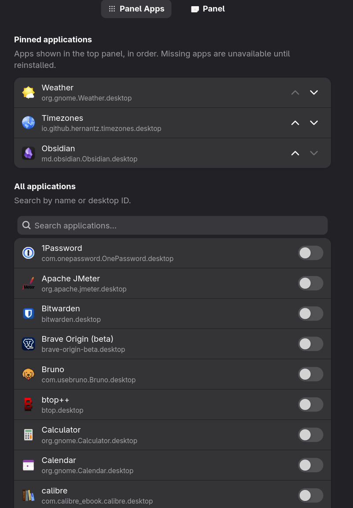
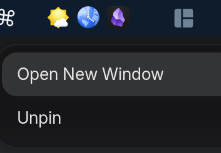

# PinBar

A GNOME Shell extension that pins selected installed applications to the top
panel. Search the application catalogue in Preferences, then click an icon to
launch or focus its application.

Vibe-coded with DeepSeek (coding & planning) and ChatGPT (planning).

> **Working interpretation of "tray"**: persistent app launch/focus icons in the
> top panel. This is **not** a native tray-protocol (StatusNotifierItem /
> AppIndicator) host, and it does not intercept window-close events.

## Features

- Pin any discoverable GUI app to the top panel and launch/focus it.
- Searchable application picker (by localized name or desktop ID) in Preferences.
- Move Up / Move Down ordering, panel placement (left/center/right + index),
  icon size (16–32) and a running indicator.
- Right-click an icon for Open New Window (when supported) and Unpin.
- Event-driven catalogue updates — no polling.

## Requirements

- Fedora Workstation on **Wayland** (tested on Fedora 44)
- GNOME Shell **50** (tested on 50.5)

## Install

See [`INSTALL.md`](INSTALL.md), or build and install the packaged bundle:

```sh
./build.sh
gnome-extensions install pinbar@work_in_progress.shell-extension.zip
```

## Documentation

- [Extension README](pinbar@work_in_progress/README.md) — usage, settings,
  limitations and compatibility.
- [Changelog](pinbar@work_in_progress/CHANGELOG.md)
- [Release notes](RELEASE-NOTES.md)

## Testing

```sh
gjs -m tests/run-tests.js
```

## Screenshots






## License

GPL-2.0-or-later. See [LICENSE](pinbar@work_in_progress/LICENSE).
